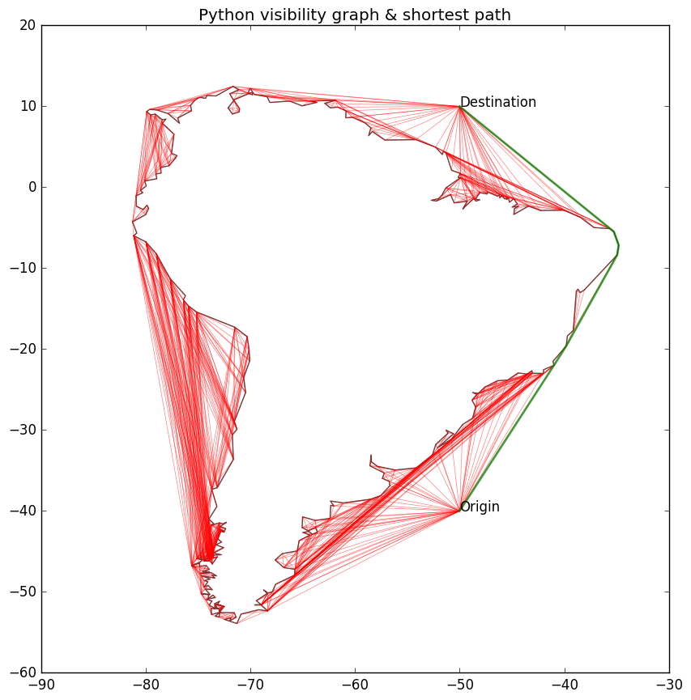
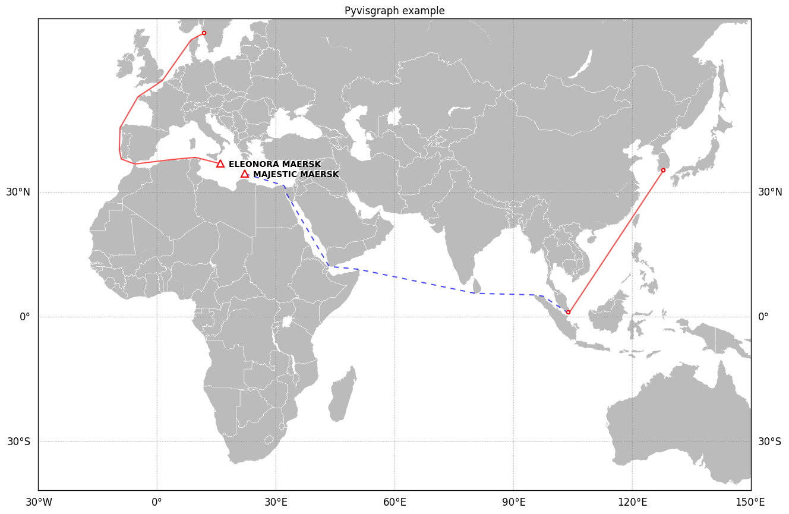

# Pyvisgraph - Python Visibility Graph

[](/LICENSE.txt)
[](https://pypi.python.org/pypi/pyvisgraph)

Given a set of simple obstacle polygons, build a visibility graph and find
the shortest path between two points.



Pyvisgraph is a MIT-licensed Python package for building visibility graphs from
a list of simple obstacle polygons. The visibility graph algorithm (D.T. Lee)
runs in O(n^2 log n) time. The shortest path is found using Djikstra's
algorithm.

To see how visibility graphs work interactively, take a look at the
[Visibility Graph Simulator](https://github.com/TaipanRex/visgraph_simulator)
built with Pyvisgraph.

## Installing Pyvisgraph
```
$ pip install pyvisgraph
```
Pyvisgraph supports Python 2 and 3.

## Usage
Here is an example of building a visibility graph given a list of
simple polygons:
```
>>> import pyvisgraph as vg
>>> polys = [[vg.Point(0.0,1.0), vg.Point(3.0,1.0), vg.Point(1.5,4.0)],
>>>          [vg.Point(4.0,4.0), vg.Point(7.0,4.0), vg.Point(5.5,8.0)]]
>>> g = vg.VisGraph()
>>> g.build(polys)
>>> shortest = g.shortest_path(vg.Point(1.5,0.0), vg.Point(4.0, 6.0))
>>> print shortest
[Point(1.50, 0.00), Point(3.00, 1.00), Point(4.00, 6.00)]
```
Once the visibility graph is built, it can be saved and subsequently loaded.
This is useful for large graphs where build time is long. `pickle` is used
for saving and loading.
```
>>> g.save('graph.pk1')
>>> g2 = VisGraph()
>>> g2.load('graph.pk1')
```
For obstacles with a large number of points, Pyvisgraph can take advantage of
processors with multiple cores using the `multiprocessing` module. Simply
add the number of workers (processes) to the `build` method:
```
>>> g.build(polys, workers=4)
```
Pyvisgraph also has some useful helper functions:
* `g.update([list of Points])`: Updates the visibility graph
  by checking visibility of each `Point` in the list.
* `g.point_in_polygon(Point)`: Check if `Point` is in the interior of any of
  the obstacle polygons. Returns the polygon_id of said polygon, -1 if not
  inside any polygon.
* `g.closest_point(Point, polygon_id)`: Return the closest point outside
  polygon with polygon_id from Point.

For further examples, please look at the scripts provided in the `examples`
folder.

## Incremental survey revisions
`SurveyGraph` publishes station-to-station routes over stable survey ids and
applies mapping corrections as atomic batches. The first revision builds the
full visibility graph plus an index of the pairs each fence can affect; later
revisions only re-check fences and nodes touched by the correction.

```
>>> from pyvisgraph import SurveyGraph, Station, Vertex, PolygonDef, SurveyCorrection
>>> fence = PolygonDef('fence-1', [Vertex('v1', 0, 0), Vertex('v2', 10, 0),
...                                Vertex('v3', 10, 10), Vertex('v4', 0, 10)])
>>> survey = SurveyGraph([fence], [Station('st-a', -5, 5),
...                                Station('st-b', 15, 5)])
>>> survey.shortest_path('st-a', 'st-b')
['st-a', 'v1', 'v2', 'st-b']
>>> old_routes = dict(survey.routes)
>>> report = survey.apply(SurveyCorrection(polygons_removed=['fence-1']))
>>> report.added_edges
[EdgeChange(('station', 'st-a'), ('station', 'st-b'))]
>>> report.removed_edges[:2]
[EdgeChange(('station', 'st-a'), ('vertex', 'v1')), ...]
>>> report.route_changes[0].new_path
['st-a', 'st-b']
>>> replayed = report.replay(old_routes)
>>> replayed == survey.routes
True
```

A correction can add, remove, or redefine whole polygons, move vertices, add or
remove stations, and move stations. Everything in one `SurveyCorrection` is
applied atomically; an invalid batch raises `SurveyError` and leaves the
published revision untouched.

`report.added_edges` and `report.removed_edges` contain the complete
visibility-edge delta. `report.vertex_edges_added` /
`report.vertex_edges_removed` and `report.station_edges_added` /
`report.station_edges_removed` expose the vertex-only and station-incident
subsets. Every edge is identified by stable ids, so it can be matched to the
previous publication. `report.route_changes` lists each station pair whose
path or length changed, including pairs that became reachable or unreachable.
Equal-length routes are ordered by the lexicographically first sequence of
stable ids.

`report.replay(old_routes)` returns the corrected route mapping. A full rebuild
of the same corrected survey produces the same mapping, which is covered by
the tests.

## Example & performance
This example uses a shapefile representing world shorelines as obstacles.
Two vessels were picked randomly and their current location found
using [AIS](https://en.wikipedia.org/wiki/Automatic_identification_system). Red
lines are laden voyage legs (carrying cargo) and dotted blue lines are ballast
legs (no cargo, moving to load destination). Pyvisgraph has the following
performance on a Microsoft Surface Pro 3 (Intel i7-4650U @ 1.7Ghz, 8GB DDR3
RAM), where time is in seconds:
```
Shoreline obstacle graph [points: 4335 edges: 4335]
Using 4 worker processes...
Time to create visibility graph: 554.683238029
Visibility graph edges: 118532
Time to update visgraph & find shortest path: 1.09287905693
Shorest path nodes: 19
Time to find shortest path between existing points: 0.508340835571
```
For one vessel the origin and destination Points were not part of the built
visibility graph and had to first be computed. For the second vessel, these
Points were first added to the visibility graph using `update`, then finding
the shortest path is faster. Using Matplotlib basemap to visualize the routes:


For more information about the implementation, see these series of articles:
* [Distance Tables Part 1: Defining the Problem](https://taipanrex.github.io/2016/09/17/Distance-Tables-Part-1-Defining-the-Problem.html)
* [Distance Tables Part 2: Lee's Visibility Graph Algorithm](https://taipanrex.github.io/2016/10/19/Distance-Tables-Part-2-Lees-Visibility-Graph-Algorithm.html)
* More to come...
