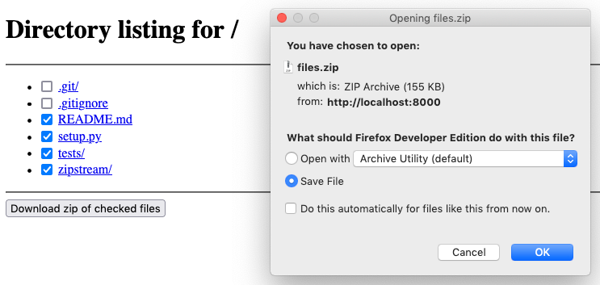

zipstream-ng
============
[](https://github.com/pR0Ps/zipstream-ng/actions/workflows/tests.yml?query=branch%3Amaster)
[](https://pypi.org/project/zipstream-ng/)


A modern and easy to use streamable zip file generator. It can package and stream many files and
folders into a zip on the fly without needing temporary files or excessive memory. It can also
calculate the final size of the zip file before streaming it.


### Features:
 - Generates zip data on the fly as it's requested.
 - Can calculate the total size of the resulting zip file before generation even begins.
 - Low memory usage: Since the zip is generated as it's requested, very little has to be kept in
   memory (peak usage of less than 20MB is typical, even for TBs of files).
 - Performant: On-par or faster than using the standard library to create non-streamed zip files.
 - Flexible API: Typical use cases are simple, complicated ones are possible.
 - Supports zipping data from files, bytes, strings, and any other iterable objects.
 - Keeps track of the date of the most recently modified file added to the zip file.
 - Threadsafe: Won't mangle data if multiple threads concurrently add data to the same stream.
 - Includes a clone of Python's `http.server` module with zip support added. Try `python -m zipstream.server`.
 - Automatically uses Zip64 extensions, but only if they are required.
 - No external dependencies.


### Ideal for web backends:
 - Generating zip data on the fly requires very little memory, no disk usage, and starts producing
   data with less latency than creating the entire zip up-front. This means faster responses, no
   temporary files, and very low memory usage.
 - The ability to calculate the total size of the stream before any data is actually generated
   (provided no compression is used) means web backends can provide a `Content-Length` header in
   their responses. This allows clients to show a progress bar as the stream is transferred.
 - By keeping track of the date of the most recently modified file added to the zip, web
   backends can provide a `Last-Modified` header. This allows clients to check if they have the most
   up-to-date version of the zip with just a HEAD request instead of having to download the entire
   thing.


Installation
------------
```
pip install zipstream-ng
```


Examples
--------

### Create a local zip file (simple example)

Make an archive named `files.zip` in the current directory that contains all files under
`/path/to/files`.

```python
from zipstream import ZipStream

zs = ZipStream.from_path("/path/to/files/")

with open("files.zip", "wb") as f:
    f.writelines(zs)
```


### Create a local zip file (demos more of the API)

```python
from zipstream import ZipStream, ZIP_DEFLATED

# Create a ZipStream that uses the maximum level of Deflate compression.
zs = ZipStream(compress_type=ZIP_DEFLATED, compress_level=9)

# Set the zip file's comment.
zs.comment = "Contains compressed important files"

# Add all the files under a path.
# Will add all files under a top-level folder called "files" in the zip.
zs.add_path("/path/to/files/")

# Add another file (will be added as "data.txt" in the zip file).
zs.add_path("/path/to/file.txt", "data.txt")

# Add some random data from an iterable.
# This generator will only be run when the stream is generated.
def random_data():
    import random
    for _ in range(10):
        yield random.randbytes(1024)

zs.add(random_data(), "random.bin")

# Add a file containing some static text.
# Will automatically be encoded to bytes before being added (uses utf-8).
zs.add("This is some text", "README.txt")

# Write out the zip file as it's being generated.
# At this point the data in the files will be read in and the generator
# will be iterated over.
with open("files.zip", "wb") as f:
    f.writelines(zs)
```


### zipserver (included)

A fully-functional and useful example can be found in the included
[`zipstream.server`](zipstream/server.py) module. It's a clone of Python's built in `http.server`
with the added ability to serve multiple files and folders as a single zip file. Try it out by
installing the package and running `zipserver --help` or `python -m zipstream.server --help`.




### Integration with a Flask webapp

A very basic [Flask](https://flask.palletsprojects.com/)-based file server that streams all the
files under the requested path to the client as a zip file. It provides the total size of the stream
in the `Content-Length` header so the client can show a progress bar as the stream is downloaded. It
also provides a `Last-Modified` header so the client can check if it already has the most recent
copy of the zipped data with a `HEAD` request instead of having to download the file and check.

Note that while this example works, it's not a good idea to deploy it as-is due to the lack of input
validation and other checks.

```python
import os.path
from flask import Flask, Response
from zipstream import ZipStream

app = Flask(__name__)

@app.route("/", defaults={"path": "."})
@app.route("/<path:path>")
def stream_zip(path):
    name = os.path.basename(os.path.abspath(path))
    zs = ZipStream.from_path(path)
    return Response(
        zs,
        mimetype="application/zip",
        headers={
            "Content-Disposition": f"attachment; filename={name}.zip",
            "Content-Length": len(zs),
            "Last-Modified": zs.last_modified,
        }
    )

if __name__ == "__main__":
    app.run(host="0.0.0.0", port=5000)
```


### Partial generation and last-minute file additions

It's possible to generate the zip stream, but stop before finalizing it. This enables adding
something like a file manifest or compression log after all the files have been added.

`ZipStream` provides a `info_list` method that returns information on all the files added to the
stream. In this example, all that information will be added to the zip in a file named
"manifest.json" before finalizing it.

```python
from zipstream import ZipStream
import json

def gen_zipfile():
    zs = ZipStream.from_path("/path/to/files")
    yield from zs.all_files()
    zs.add(
        json.dumps(
            zs.info_list(),
            indent=2
        ),
        "manifest.json"
    )
    yield from zs.finalize()
```


### One read-once source, many independent zip downloads

Sometimes the same export has to be sent to several consumers at once, and the
underlying data members come from a stream that can only be read once.
`ZipFanout` generates the source members a single time and fans the bytes out to
any number of subscribers. Each subscriber gets its own standalone, valid zip
(its own local headers, central directory and end-of-central-directory record),
so the packages are independent even though the source is shared.

A subscriber either asks for the **complete** package or lists the specific
members it wants:

```python
from zipstream import ZipStream, ZipFanout

source = ZipStream()
source.add(read_x_once(), "x")   # an iterable that can only be read once
source.add(read_y_once(), "y")

fanout = ZipFanout(source, staging_limit=1024 * 1024)

# Promised every member - if the source fails this raises SourceIncomplete
# instead of silently delivering a zip with missing files.
auditor_a = fanout.subscribe("auditor-a", complete=True)

# Only wants some members, but still receives a complete, standalone zip whose
# central directory lists just those members.
auditor_b = fanout.subscribe("auditor-b", members=["x"])
auditor_c = fanout.subscribe("auditor-c", members=["y"])

fanout.run_threaded()  # or .run() to drive the source on the current thread

data_a = b"".join(auditor_a)
data_b = b"".join(auditor_b)
data_c = b"".join(auditor_c)
```

Key guarantees:

 - **Read once.** The source members are iterated exactly once. Cancelling a
   subscriber (`subscriber.close()`) never re-opens a source iterator and never
   changes the member offsets already published to any other subscriber.
 - **Independent offsets.** Every subscriber rebuilds local headers and the
   central directory with its own offsets, so one subscriber's packaging never
   leaks into another's.
 - **Bounded staging.** `staging_limit` is the fixed byte budget used to let a
   slow subscriber catch up. Bytes every remaining subscriber has moved past are
   reclaimed. A subscriber that falls outside what staging can still hold is
   failed explicitly with `StagingWindowExpired` (which reports the end of its
   resumable window via `window_end_offset`) rather than being allowed to stall
   the faster subscribers.
 - **No silent previews.** If the source iterator fails partway through, only
   subscribers that received at least one fully-completed entry can deliver; the
   members they are missing are listed on `subscriber.missing`. A
   `complete=True` subscriber (and any subscriber that got no complete entry)
   raises `SourceIncomplete` instead of delivering a truncated-looking zip.


Comparison to stdlib
--------------------
Since Python 3.6 it has actually been possible to generate zip files as a stream using just the
standard library, it just hasn't been very ergonomic or efficient. Consider the typical use case of
zipping up a directory of files while streaming it over a network connection:

(note that the size of the stream is not pre-calculated in this case as this would make the stdlib
example way too long).

Using ZipStream:
```python
from zipstream import ZipStream

send_stream(
    ZipStream.from_path("/path/to/files/")
)
```

<details>
<summary>The same(ish) functionality using just the stdlib:</summary>

```python
import os
import io
from zipfile import ZipFile, ZipInfo

class Stream(io.RawIOBase):
    """An unseekable stream for the ZipFile to write to"""

    def __init__(self):
        self._buffer = bytearray()
        self._closed = False

    def close(self):
        self._closed = True

    def write(self, b):
        if self._closed:
            raise ValueError("Can't write to a closed stream")
        self._buffer += b
        return len(b)

    def readall(self):
        chunk = bytes(self._buffer)
        self._buffer.clear()
        return chunk

def iter_files(path):
    for dirpath, _, files in os.walk(path, followlinks=True):
        if not files:
            yield dirpath  # Preserve empty directories
        for f in files:
            yield os.path.join(dirpath, f)

def read_file(path):
    with open(path, "rb") as fp:
        while True:
            buf = fp.read(1024 * 64)
            if not buf:
                break
            yield buf

def generate_zipstream(path):
    stream = Stream()
    with ZipFile(stream, mode="w") as zf:
        toplevel = os.path.basename(os.path.normpath(path))
        for f in iter_files(path):
            # Use the basename of the path to set the arcname
            arcname = os.path.join(toplevel, os.path.relpath(f, path))
            zinfo = ZipInfo.from_file(f, arcname)

            # Write data to the zip file then yield the stream content
            with zf.open(zinfo, mode="w") as fp:
                if zinfo.is_dir():
                    continue
                for buf in read_file(f):
                    fp.write(buf)
                    yield stream.readall()
    yield stream.readall()

send_stream(
    generate_zipstream("/path/to/files/")
)
```
</details>


Tests
-----
This package contains extensive tests. To run them, install `pytest` (`pip install pytest`) and run
`py.test` in the project directory.


License
-------
Licensed under the [GNU LGPLv3](https://www.gnu.org/licenses/lgpl-3.0.html).
